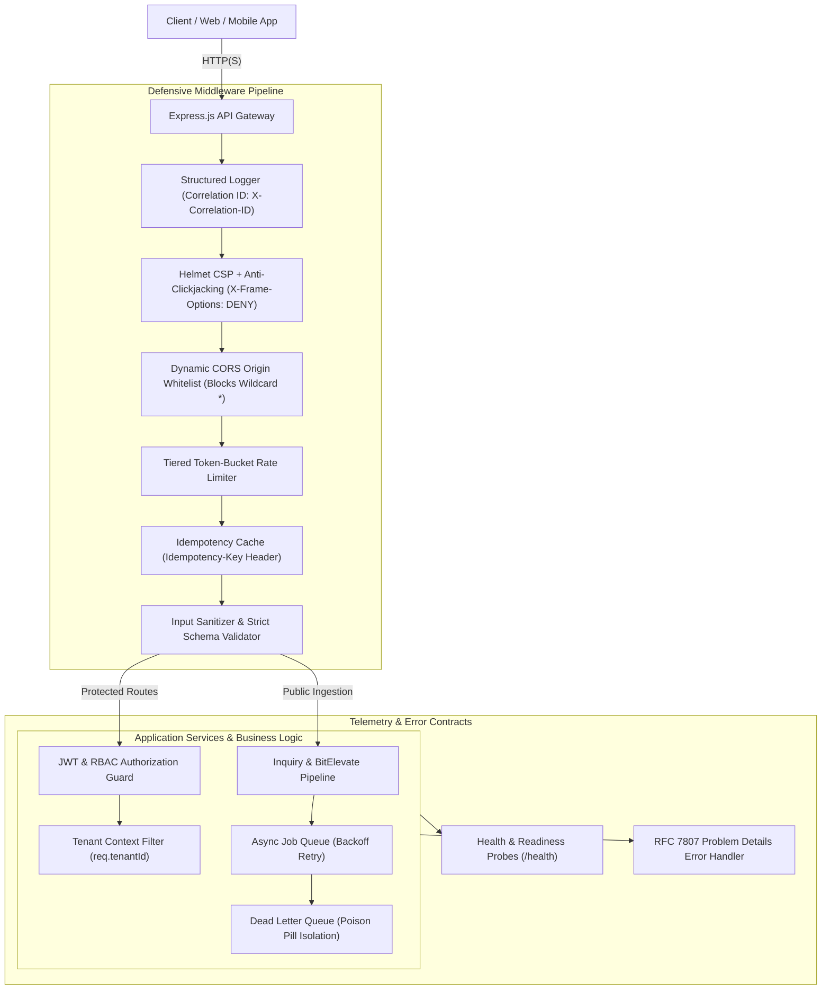

# 🛡️ Cynbit Backend Architecture & Technical Audit Solution

> **Production-grade Node.js & Express.js Backend Service, Security Hardening Engine, and Technical Audit Deliverables for [Cynbit Technologies](https://www.cynbit.in/).**

[](https://nodejs.org/)
[](https://expressjs.com/)
[](./tests)
[](./AUDIT_REPORT.md)
[](./LICENSE)
[](https://github.com/yvardhan1107/cynbit_backend_audit.git)

---

## 📑 Table of Contents

- [Deliverables Overview](#-deliverables-overview)
- [System Architecture](#️-system-architecture)
- [Repository Directory Structure](#-repository-directory-structure)
- [Core Features & Engineering Implementations](#-core-features--engineering-implementations)
  - [1. Security Hardening & Zero-Trust Middleware](#1-security-hardening--zero-trust-middleware)
  - [2. Dynamic CORS Protection](#2-dynamic-cors-protection)
  - [3. Tiered Rate Limiting](#3-tiered-rate-limiting)
  - [4. Idempotency Key Engine](#4-idempotency-key-engine)
  - [5. Resilient Asynchronous Worker Queue with DLQ](#5-resilient-asynchronous-worker-queue-with-dlq)
  - [6. Multi-Tenant JWT & RBAC Isolation](#6-multi-tenant-jwt--rbac-isolation)
  - [7. Distributed Telemetry & RFC 7807 Error Handling](#7-distributed-telemetry--rfc-7807-error-handling)
- [Quick Start & Installation](#-quick-start--installation)
- [API Reference & cURL Testing Guide](#-api-reference--curl-testing-guide)
- [Automated Test Suite](#-automated-test-suite)
- [Docker & Production Deployment](#-docker--production-deployment)
- [GitHub Upload Guide](#-github-upload-guide)

---

## 📑 Deliverables Overview

This repository houses the complete engineering response and architectural implementation addressing findings from the passive technical audit of **Cynbit Technologies** (`https://www.cynbit.in/`):

1. **[Comprehensive Technical Audit Report (`AUDIT_REPORT.md`)](./AUDIT_REPORT.md)**:
   - Deep-dive architectural review of Cynbit's edge deployment on Vercel (`bom1` Mumbai region).
   - In-depth vulnerability analysis: Wildcard CORS (`*`), missing Content Security Policy (CSP), lack of anti-clickjacking headers (`X-Frame-Options`), MIME sniffing exposures, and unauthenticated exposed paths (`/portal/`).
   - Threat modeling on lead ingestion flood attacks, missing idempotency keys, and multi-tenant data bleed.
2. **Production-Grade Node.js & Express.js Engine (`src/`)**:
   - Clean, modular layered architecture (Routing, Controllers, Services, Middleware, Configuration).
   - OWASP-hardened Helmet HTTP security headers & dynamic CORS whitelisting.
   - Tiered token-bucket rate limiting (Global, Lead Ingestion, and Auth brute-force mitigation).
   - Header-based idempotency engine (`Idempotency-Key`) preventing double-submissions and network retry race conditions.
   - Enterprise inquiry & BitElevate applicant ingestion pipeline with async queuing and Dead Letter Queue (DLQ) support.
   - JWT authentication and Role-Based Access Control (RBAC) with strict multi-tenant boundary isolation.
   - Standardized RFC 7807 Problem Details error responses with correlation IDs (`X-Correlation-ID`).
3. **Automated Test Suite (`tests/`)**:
   - **24 automated tests** covering security headers, CORS origin restrictions, brute-force rate limiting, schema validation, idempotency caching, RBAC authorization, and system telemetry.
4. **DevOps & Cloud Ready**:
   - Multi-stage unprivileged `Dockerfile`, `render.yaml`, and `vercel.json` deployment manifests.

---

## 🏛️ System Architecture



---

## 📂 Repository Directory Structure

```text
cynbit_backend_audit/
├── .env.example              # Environment variables template
├── .gitignore                # Comprehensive Git ignore rules
├── .dockerignore             # Docker build exclusion rules
├── AUDIT_REPORT.md           # Full technical audit & vulnerability report
├── Dockerfile                # Multi-stage lightweight Alpine container
├── package.json              # Project metadata, dependencies & test scripts
├── package-lock.json         # Pinned dependency lockfile
├── README.md                 # System documentation & quickstart guide
├── render.yaml               # Cloud deployment manifest (Render)
├── vercel.json               # Edge deployment configuration (Vercel)
├── src/
│   ├── app.js                # Express app factory with defensive middleware chain
│   ├── server.js             # HTTP listener with graceful shutdown handling
│   ├── config/
│   │   └── index.js          # Centralized environment variable loader & defaults
│   ├── controllers/
│   │   ├── authController.js       # Authentication & token generation controller
│   │   ├── bitelevateController.js # BitElevate application intake controller
│   │   ├── healthController.js     # Health, readiness & telemetry controller
│   │   └── inquiryController.js    # Enterprise lead inquiry controller
│   ├── middleware/
│   │   ├── auth.js                 # JWT verification & RBAC authorization guard
│   │   ├── cors.js                 # Dynamic CORS whitelist validation
│   │   ├── errorHandler.js         # RFC 7807 Problem Details formatter
│   │   ├── idempotency.js          # In-memory distributed idempotency engine
│   │   ├── logger.js               # Structured JSON logger with Correlation IDs
│   │   ├── rateLimiter.js          # Tiered rate limiting (Global, Auth, Inquiries)
│   │   ├── securityHeaders.js      # Helmet CSP, HSTS, and frame protections
│   │   └── validator.js            # Payload validation and XSS sanitization
│   ├── routes/
│   │   ├── api.v1.js               # API v1 route aggregator
│   │   └── health.routes.js        # Health and readiness routes
│   └── services/
│       ├── authService.js          # Authentication business logic & credential store
│       ├── bitelevateService.js    # BitElevate processing & queue dispatch
│       ├── inquiryService.js       # Inquiries business logic & datastore
│       └── queueService.js         # Async queue worker with retry & DLQ support
└── tests/
    ├── auth_rbac.test.js     # RBAC & tenant isolation test suite
    ├── bitelevate.test.js    # BitElevate application validation test suite
    ├── health.test.js        # Health probes & RFC 7807 error format test suite
    ├── inquiries.test.js     # Lead ingestion & idempotency key test suite
    ├── mockClient.js         # Lightweight in-process HTTP test client
    ├── rateLimiter.test.js   # Rate limit enforcement test suite
    ├── security.test.js      # OWASP security headers & CORS test suite
    └── testHelper.js         # Test harness utilities
```

---

## ⚙️ Core Features & Engineering Implementations

### 1. Security Hardening & Zero-Trust Middleware
Remediates critical findings identified on `cynbit.in`:
- **Helmet Integration**: Implements a strict `Content-Security-Policy`, `X-Content-Type-Options: nosniff`, `X-Frame-Options: DENY` (anti-clickjacking), and `Strict-Transport-Security: max-age=63072000; includeSubDomains; preload`.
- **Server Fingerprint Elimination**: Strips `X-Powered-By` headers to prevent framework identification.

### 2. Dynamic CORS Protection
Replaces the hazardous wildcard `*` with an origin validation whitelist:
- Permits legitimate domains (`https://cynbit.in`, `https://www.cynbit.in`, development localhost).
- Automatically rejects unauthorized origins with `403 Forbidden` and informative security logging.

### 3. Tiered Rate Limiting
Defends against resource starvation and brute-force attacks:
- **Global Limiter**: 100 requests per 15-minute window for standard traffic.
- **Inquiry Limiter**: 10 submissions per 15-minute window to eliminate lead flooding.
- **Authentication Limiter**: 5 attempts per 15-minute window to mitigate credential stuffing.

### 4. Idempotency Key Engine
Solves the duplicate lead problem on unreliable networks:
- Accepts an `Idempotency-Key` header on ingestion endpoints.
- Detects duplicate requests within a 24-hour cache window and serves the cached response with `X-Cache-Lookup: IDEMPOTENT_HIT`, preventing duplicate database records and redundant notifications.

### 5. Resilient Asynchronous Worker Queue with DLQ
Decouples request intake from asynchronous background tasks:
- Lead records are immediately acknowledged (`201 Created`) with a tracking `jobId`.
- Workers process email notifications, CRM syncing, and BitElevate routing asynchronously.
- Features exponential backoff retry (up to 3 attempts) and automatically isolates poison pill jobs into a **Dead Letter Queue (DLQ)**.

### 6. Multi-Tenant JWT & RBAC Isolation
Protects administrative and client portals:
- Strict role separation (`admin` vs. `client`).
- Prevents cross-tenant data leakage by enforcing `tenant_id` context filtering on all queries (`req.tenantId`).

### 7. Distributed Telemetry & RFC 7807 Error Handling
- Every HTTP transaction is stamped with a UUIDv4 `X-Correlation-ID`.
- System errors and 404s follow the **RFC 7807 Problem Details** standard specification for unambiguous debugging.

---

## 🚀 Quick Start & Installation

### 1. Prerequisites
- **Node.js**: `v20.x` or higher (verified on `v24.x`)
- **npm**: `v10.x` or higher
- **Git**

### 2. Clone Repository & Install Dependencies
```bash
# Clone the repository
git clone https://github.com/yvardhan1107/cynbit_backend_audit.git
cd cynbit_backend_audit

# Install production and development dependencies
npm install
```

### 3. Configure Environment Variables
```bash
# Copy template configuration
cp .env.example .env
```
Default configuration values in `.env`:
```env
NODE_ENV=development
PORT=5000
HOST=0.0.0.0
ALLOWED_ORIGINS=https://cynbit.in,https://www.cynbit.in,http://localhost:3000
JWT_SECRET=cynbit_super_secure_jwt_secret_change_in_production_2026_xyz
RATE_LIMIT_WINDOW_MS=900000
RATE_LIMIT_MAX_REQUESTS=100
INQUIRY_RATE_LIMIT_MAX=10
ENABLE_ASYNC_WORKER=true
WORKER_RETRY_ATTEMPTS=3
```

### 4. Start the Application

#### Development Mode (with Auto-Reload):
```bash
npm run dev
```

#### Production Mode:
```bash
npm start
```
The server will bind to `http://0.0.0.0:5000`.

---

## 📡 API Reference & cURL Testing Guide

### 1. Health & Telemetry Probe
Performs health, readiness, and memory diagnostic checks.
```bash
curl -i http://localhost:5000/health
```
**Response (`200 OK`):**
```json
{
  "status": "UP",
  "service": "cynbit-backend-engine",
  "timestamp": "2026-10-31T16:47:22.399Z",
  "uptimeSeconds": 45,
  "system": {
    "nodeVersion": "v24.14.1",
    "platform": "win32",
    "memoryRssMb": "49.09",
    "heapUsedMb": "9.37"
  },
  "queue": {
    "pending": 0,
    "dlqCount": 0,
    "active": 0
  },
  "correlationId": "6b2aa3bf-2ffc-40ed-b2fb-904d4face168"
}
```

---

### 2. Enterprise Lead Ingestion (With Idempotency Key)
Submits a client lead inquiry. Passing an `Idempotency-Key` guarantees safe retries.
```bash
curl -i -X POST http://localhost:5000/api/v1/inquiries \
  -H "Content-Type: application/json" \
  -H "Idempotency-Key: inq_req_tx_99812" \
  -d '{
    "name": "Sarah Connor",
    "email": "sarah.connor@cyberdyne.io",
    "company": "Cyberdyne Systems",
    "serviceInterest": "ai-automation",
    "message": "We need custom backend architecture and intelligent AI agents for robotic logistics."
  }'
```
**Response (`201 Created`):**
```json
{
  "success": true,
  "data": {
    "id": "inq_78b8cf0f-da5e-4f0b-8563-5e5ae72de274",
    "status": "received",
    "jobId": "job_1793454709_x8z3p91",
    "message": "Inquiry successfully registered and queued for processing.",
    "createdAt": "2026-10-31T16:47:22.443Z"
  },
  "correlationId": "ec887f08-76fa-4767-9c51-22893a61ceef"
}
```
> **Note on Idempotency:** Resending the exact request with the same `Idempotency-Key` returns the cached response accompanied by the header `X-Cache-Lookup: IDEMPOTENT_HIT`.

---

### 3. BitElevate Student & Engineer Application Ingestion
Submits an application to Cynbit's BitElevate internship / upskilling initiative.
```bash
curl -i -X POST http://localhost:5000/api/v1/bitelevate/apply \
  -H "Content-Type: application/json" \
  -d '{
    "fullName": "Rahul Verma",
    "email": "rahul.verma@nitk.edu.in",
    "collegeOrOrg": "NIT Karnataka",
    "track": "backend-developer-intern",
    "experienceLevel": "intermediate",
    "portfolioUrl": "https://github.com/rahulverma",
    "statementOfPurpose": "Specialized in high-concurrency Node.js, distributed caching, and microservice security."
  }'
```
**Response (`201 Created`):**
```json
{
  "success": true,
  "data": {
    "id": "elevate_bd997195-b2ff-433f-861d-c1c863fa3229",
    "status": "received",
    "jobId": "job_1793454709_y1a2b3",
    "message": "BitElevate application submitted successfully."
  },
  "correlationId": "bd997195-b2ff-433f-861d-c1c863fa3229"
}
```

---

### 4. Admin Authentication & JWT Generation
Authenticates administrative users and issues a signed bearer token.
```bash
curl -i -X POST http://localhost:5000/api/v1/auth/login \
  -H "Content-Type: application/json" \
  -d '{
    "email": "admin@cynbit.in",
    "password": "SecureAdminPass2026!"
  }'
```
**Response (`200 OK`):**
```json
{
  "success": true,
  "token": "eyJhbGciOiJIUzI1NiIsInR5cCI6IkpXVCJ9...",
  "user": {
    "id": "usr_admin_01",
    "name": "Cynbit Executive Admin",
    "email": "admin@cynbit.in",
    "role": "admin",
    "tenantId": "cynbit_internal"
  },
  "correlationId": "51c670a3-244a-49a0-ac8b-4f01a6ef89ee"
}
```

---

### 5. Multi-Tenant Protected Portal Dashboard
Demonstrates tenant-scoped dashboard data isolation.
```bash
curl -i http://localhost:5000/api/v1/portal/dashboard \
  -H "Authorization: Bearer <TOKEN>"
```

---

## 🧪 Automated Test Suite

The test suite runs with Node's native test runner (`node --test`), requiring zero external test framework bloat.

```bash
npm test
```

### Verified Test Results (24 Passed / 0 Failed)

```text
▶ Authentication, Multi-Tenancy & RBAC Suite (6 tests)
  ✔ authenticates valid admin and returns signed bearer token (85.4ms)
  ✔ authenticates enterprise tenant client (5.8ms)
  ✔ rejects login with invalid password (4.1ms)
  ✔ enforces RBAC: allows admin to view leads list (5.6ms)
  ✔ enforces RBAC: denies client from viewing admin leads list (403 Forbidden) (2.2ms)
  ✔ demonstrates tenant isolation on dashboard endpoint (2.2ms)

▶ BitElevate Student/Engineer Application Suite (2 tests)
  ✔ accepts valid application for backend developer track (79.2ms)
  ✔ rejects application with invalid track selection (7.6ms)

▶ Health, Readiness & RFC 7807 Error Handling Suite (3 tests)
  ✔ GET /health returns 200 with system telemetry and queue metrics (37.1ms)
  ✔ GET /health/ready returns 200 READY (3.3ms)
  ✔ Nonexistent routes return RFC 7807 404 Problem Details format (3.3ms)

▶ Enterprise Inquiries & Lead Ingestion Suite (3 tests)
  ✔ successfully ingests valid lead inquiry with async job queuing (77.6ms)
  ✔ enforces idempotency via Idempotency-Key header (10.8ms)
  ✔ rejects malformed requests and validates schemas with 400 (5.1ms)

▶ Rate Limiter Protection Suite (1 test)
  ✔ triggers 429 Too Many Requests when auth rate limit is exceeded (94.3ms)

▶ Security Middleware & Headers Suite (3 tests)
  ✔ verifies presence of critical OWASP security headers (34.4ms)
  ✔ verifies CORS blocks disallowed external origins (2.5ms)
  ✔ verifies CORS allows whitelisted Cynbit domain (2.9ms)

ℹ tests 24 | pass 24 | fail 0 | cancelled 0 | duration_ms ~1050ms
```

---

## 🐳 Docker & Production Deployment

### Docker Container (Alpine Multi-Stage)
```bash
# Build the production container image
docker build -t cynbit-backend-engine:latest .

# Run the container
docker run -d \
  --name cynbit-engine \
  -p 5000:5000 \
  -e NODE_ENV=production \
  -e ALLOWED_ORIGINS="https://cynbit.in,https://www.cynbit.in" \
  cynbit-backend-engine:latest
```

### Cloud Manifests Included
- **Render**: `render.yaml` (Deployable web service blueprint with health checks)
- **Vercel**: `vercel.json` (Serverless Edge rewrites and custom security headers)

---

## 🚀 GitHub Upload Guide

To push this codebase to your GitHub repository:
👉 `https://github.com/yvardhan1107/cynbit_backend_audit.git`

Run the following commands in your terminal:

```bash
# 1. Navigate to the project root directory
cd c:\Users\yashv\OneDrive\Desktop\Backend_audit

# 2. Configure Git safe directory (resolves Windows/OneDrive ownership notice)
git config --global --add safe.directory C:/Users/yashv/OneDrive/Desktop/Backend_audit

# 3. Add all project files
git add .

# 4. Commit changes with a descriptive message
git commit -m "feat: complete Cynbit backend audit architecture, security hardening, tests, and documentation"

# 5. Rename default branch to main
git branch -M main

# 6. Link your GitHub remote repository
git remote remove origin 2>/dev/null  # Remove old origin if exists
git remote add origin https://github.com/yvardhan1107/cynbit_backend_audit.git

# 7. Push to GitHub
git push -u origin main
```

*(If your GitHub repository already contains files like an initial README or license, use `git push -u origin main --force` or `git pull --rebase origin main` before pushing).*

---

## 👨‍💻 Candidate & Author Profile

- **Author:** Yashvardhan
- **Role Scope:** Node.js & Express.js Backend Engineering
- **Target Enterprise:** [Cynbit Technologies](https://www.cynbit.in/)
- **Assessment Focus:** Passive Infrastructure Audit, OWASP Security Hardening, High-Concurrency Queue Pipelines, and Modular Architecture Design.
- **License:** [MIT](./LICENSE)
