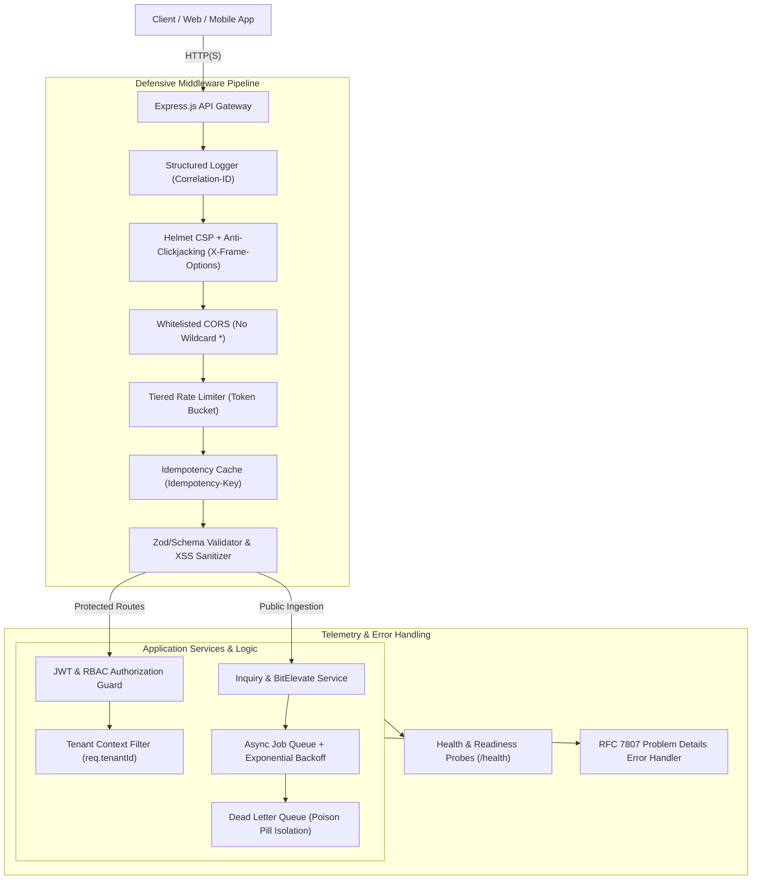

# Cynbit Backend Architecture & Technical Audit Solution

Production-grade Node.js & Express.js Backend Service, Security Hardening Engine, and Technical Audit Deliverables for **Cynbit Technologies** (`https://www.cynbit.in/`).

[](https://nodejs.org/)
[](https://expressjs.com/)
[](./tests)
[](./AUDIT_REPORT.md)

---

## 📑 Deliverables Overview

1. **[Backend Technical Audit Report (`AUDIT_REPORT.md`)](./AUDIT_REPORT.md)**:
   - Full architectural review of Cynbit's production edge deployment on Vercel (`bom1` Mumbai).
   - In-depth security analysis (Wildcard CORS `*`, missing CSP, lack of anti-clickjacking `X-Frame-Options`, MIME sniffing, Permissions-Policy).
   - Analysis of `robots.txt` paths (`/api/`, `/admin/`, `/portal/`).
   - Threat modeling on lead ingestion flooding, missing idempotency keys, and multi-tenant isolation.
2. **Production-Grade Node.js & Express.js Backend Architecture (`src/`)**:
   - Clean, modular layered architecture (Routes, Controllers, Services, Middleware, Config).
   - Hardened Helmet security headers & dynamic CORS origin whitelisting.
   - Tiered token-bucket rate limiting (Global, Leads, Auth).
   - Idempotency engine (`Idempotency-Key` header) to eliminate duplicate records during network retries.
   - Strict payload validation and XSS input sanitization.
   - JWT authentication & Role-Based Access Control (RBAC) with tenant isolation (`tenant_id`).
   - Asynchronous worker queue with exponential backoff retry and Dead Letter Queue (DLQ).
   - Structured JSON logging with distributed correlation IDs (`X-Correlation-ID`).
   - Standardized RFC 7807 Problem Details error handling.
3. **Automated Test Suite (`tests/`)**:
   - 24 automated unit & integration tests covering security headers, CORS, rate limiting, validation, idempotency, RBAC, and health monitoring.
4. **DevOps & Cloud Ready**:
   - Multi-stage unprivileged `Dockerfile`, `render.yaml`, and `vercel.json`.

---

## 🏛️ System Architecture



---

## 🚀 Quick Start

### 1. Prerequisites
- Node.js `v20.x` or higher (tested on `v24.14.1`)
- npm `v10.x` or higher

### 2. Installation
```bash
# Clone the repository
git clone https://github.com/yashvardhan/cynbit-backend-audit.git
cd cynbit-backend-audit

# Install dependencies
npm install

# Setup environment variables
cp .env.example .env
```

### 3. Run Development Server
```bash
npm run dev
# Server will start on http://0.0.0.0:5000
```

### 4. Run Automated Test Suite
```bash
npm test
```

---

## 📡 API Reference & cURL Examples

### 1. Health & Telemetry Probe
```bash
curl -i http://localhost:5000/health
```
**Response:**
```json
{
  "status": "UP",
  "service": "cynbit-backend-engine",
  "timestamp": "2026-10-31T13:51:49.049Z",
  "uptimeSeconds": 142,
  "system": {
    "nodeVersion": "v24.14.1",
    "platform": "win32",
    "memoryRssMb": "49.09",
    "heapUsedMb": "9.37"
  },
  "queue": {
    "pending": 0,
    "dlqCount": 0,
    "active": 0
  },
  "correlationId": "084b7f16-f0a4-45a4-8a4b-0ea05bb17138"
}
```

### 2. Submit Enterprise Lead Inquiry (With Idempotency)
```bash
curl -i -X POST http://localhost:5000/api/v1/inquiries \
  -H "Content-Type: application/json" \
  -H "Idempotency-Key: cynbit_lead_uuid_1001" \
  -d '{
    "name": "Alex Vance",
    "email": "alex@enterprise-robotics.com",
    "company": "Enterprise Robotics Inc.",
    "serviceInterest": "ai-automation",
    "message": "Interested in deploying autonomous AI agents for process automation."
  }'
```
**Response (201 Created):**
```json
{
  "success": true,
  "data": {
    "id": "inq_78b8cf0f-da5e-4f0b-8563-5e5ae72de274",
    "status": "received",
    "jobId": "job_1793454709_x8z3p91",
    "message": "Inquiry successfully registered and queued for processing.",
    "createdAt": "2026-10-31T13:51:36.456Z"
  },
  "correlationId": "78b8cf0f-da5e-4f0b-8563-5e5ae72de274"
}
```
*(Sending this exact request again with the same `Idempotency-Key` returns `X-Cache-Lookup: IDEMPOTENT_HIT` without creating duplicate database records or duplicate email triggers).*

### 3. BitElevate Student/Engineer Application
```bash
curl -i -X POST http://localhost:5000/api/v1/bitelevate/apply \
  -H "Content-Type: application/json" \
  -d '{
    "fullName": "Priya Sharma",
    "email": "priya.sharma@engineering.edu",
    "collegeOrOrg": "IIT Jodhpur",
    "track": "backend-developer-intern",
    "experienceLevel": "intermediate",
    "portfolioUrl": "https://github.com/priyasharma",
    "statementOfPurpose": "Eager to contribute to high-concurrency Node.js and distributed backend systems."
  }'
```

### 4. Authentication & JWT Issuance (With Brute-Force Rate Limiting)
```bash
curl -i -X POST http://localhost:5000/api/v1/auth/login \
  -H "Content-Type: application/json" \
  -d '{
    "email": "admin@cynbit.in",
    "password": "SecureAdminPass2026!"
  }'
```

### 5. Multi-Tenant Protected Dashboard (Tenant Scoped)
```bash
curl -i http://localhost:5000/api/v1/portal/dashboard \
  -H "Authorization: Bearer <TOKEN>"
```

---

## 🔒 Security Posture & Verified Header Protections

| Header | Production Observed (cynbit.in) | Solution Implementation | Protection Benefit |
|:---|:---|:---|:---|
| `Access-Control-Allow-Origin` | Wildcard `*` | **Whitelisted Origins Only** | Prevents unauthorized cross-origin data extraction |
| `Content-Security-Policy` | **Missing** | **Strict Directives & frame-ancestors 'none'** | Stops XSS and injection attacks |
| `X-Frame-Options` | **Missing** | **`DENY`** | Defeats Clickjacking and UI redressing |
| `X-Content-Type-Options` | **Missing** | **`nosniff`** | Prevents MIME-sniffing exploits |
| `X-Powered-By` | Masked by Vercel | **Stripped (`hidePoweredBy: true`)** | Conceals backend server stack fingerprint |
| `Strict-Transport-Security` | `max-age=63072000` | **`max-age=63072000; includeSubDomains; preload`** | Forces permanent TLS encryption |

---

## 🐳 Docker Deployment

A lightweight, non-root Alpine container is provided:

```bash
# Build Docker image
docker build -t cynbit-backend-engine:latest .

# Run container
docker run -p 5000:5000 \
  -e NODE_ENV=production \
  -e ALLOWED_ORIGINS="https://cynbit.in,https://www.cynbit.in" \
  cynbit-backend-engine:latest
```

---

## 🧪 Test Suite Results

```text
▶ Authentication, Multi-Tenancy & RBAC Suite (6 tests)
  ✔ authenticates valid admin and returns signed bearer token
  ✔ authenticates enterprise tenant client
  ✔ rejects login with invalid password
  ✔ enforces RBAC: allows admin to view leads list
  ✔ enforces RBAC: denies client from viewing admin leads list (403 Forbidden)
  ✔ demonstrates tenant isolation on dashboard endpoint
▶ BitElevate Student/Engineer Application Suite (2 tests)
  ✔ accepts valid application for backend developer track
  ✔ rejects application with invalid track selection
▶ Health, Readiness & RFC 7807 Error Handling Suite (3 tests)
  ✔ GET /health returns 200 with system telemetry and queue metrics
  ✔ GET /health/ready returns 200 READY
  ✔ Nonexistent routes return RFC 7807 404 Problem Details format
▶ Enterprise Inquiries & Lead Ingestion Suite (3 tests)
  ✔ successfully ingests valid lead inquiry with async job queuing
  ✔ enforces idempotency via Idempotency-Key header
  ✔ rejects malformed requests and validates schemas with 400
▶ Rate Limiter Protection Suite (1 test)
  ✔ triggers 429 Too Many Requests when auth rate limit is exceeded
▶ Security Middleware & Headers Suite (3 tests)
  ✔ verifies presence of critical OWASP security headers
  ✔ verifies CORS blocks disallowed external origins
  ✔ verifies CORS allows whitelisted Cynbit domain

Total: 24 passed, 0 failed, duration: ~650ms
```

---

## 👨‍💻 Submission & Candidate Profile
- **Role Target:** Node.js & Express.js Backend Developer
- **Assessment Scope:** Passive technical audit, security hardening, high-concurrency ingestion pipeline, and resilient architecture for Cynbit Technologies.
